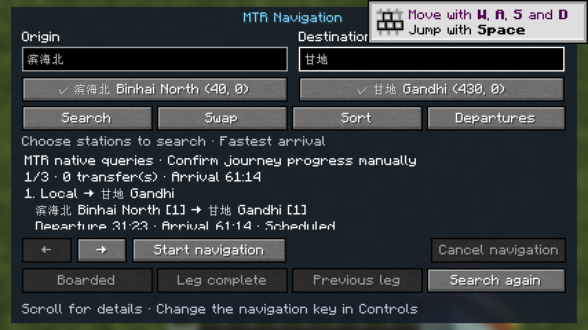
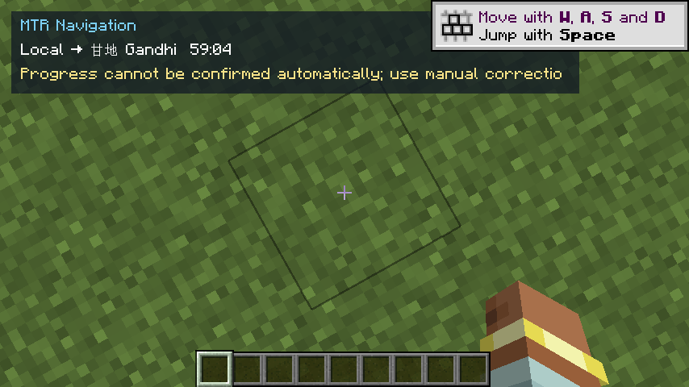
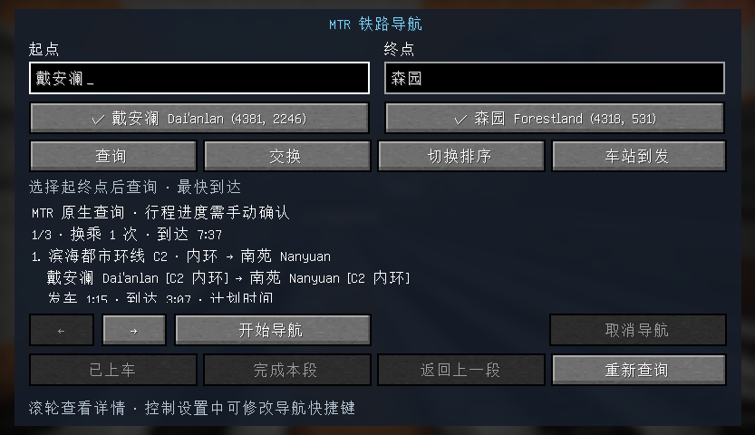

# 验证记录

日期：2026-10-25，Asia/Hong_Kong。

## 目标依赖

- Minecraft 1.21.1，Java 21；NeoForge 21.1.249；Fabric Loader 0.16.14／Fabric API 0.116.17。
- 两个 Modrinth MTR 4.1.0-beta.2 发布包已按官方元数据核对 SHA512；元数据和 JAR 位于项目 `.cache/downloads`。
- 可选 Overlay 兼容测试使用 GitHub v1.5.2 的 NeoForge 1.21.1 正式附件，并核对发布的 SHA256SUMS。

## 自动验证

23 项共用回归在 NeoForge 和 Fabric 两个实际 MTR Core 上执行，覆盖直达、换乘余量、单向线路、重复停站、同名站、显式连接、贯通、排序、范围限制、时钟过期、车辆身份、地图区间、分块组装，以及原生请求的单请求限制、超时暂停、显式重试、搜索取消和队列上限。

到发适配测试直接调用两个目标包的 `Siding.iterateArrivals`，未用模拟接口替代其签名；原生地图兼容测试使用实际 `StationAndRoutes`／`Departures` DTO 的正式 JSON 序列化。另有一项读取真实 Overlay 发布包的全网快照测试。

显式测试世界生成器默认跳过；仅 `-PgenerateFixture` 时向指定的新目录生成 MTR 运营网络，拒绝覆盖已有目标。

## NeoForge 实机证据

项目内新建 `NavTest` 测试世界，MTR 原生生成车辆段路径成功。玩家出生在约 `(2000, 2000)`，线路站台位于约 `(40, 0)`、`(230, 80)`、`(430, 0)`，不在玩家附近同步范围。

使用 `-PnativeSmoke` 强制关闭客户端对 Navigation 专用通道的使用，验证以下路径：

- MTR 原生游戏网络转发返回全网三站、三线路，及运营线路的发车数据。
- 中文完整站名“滨海北”“甘地”自动匹配，按回车得到三个候选方案，倒计时继续更新。
- 车站到发页显示站台、目的地、到达和发车倒计时及计划／实时状态。
- 开始导航后关闭窗口，HUD 继续显示，兼容路径明确要求手动推进。
- 窄窗口采用紧凑候选布局，文本清晰，不再被第二次背景模糊。

## 用户客户端及真实服务器

在用户指定的 `D:\Axolotl\profiles\1.21.1-NeoForge 21.1.251` 实例运行，NeoForge 21.1.251。服务端有 MTR 和 MTR Map Overlay，没有 Navigation。

- 实际加载的是服务器整合包的 MTR 4.1.0-beta.2 performance-v6 和 Overlay 1.5.2；Overlay 日志确认收到 72 条线路、5158 条轨道和 651 个地标。
- 实测“戴安澜 → 北野”返回三个可选方案，包含实际站台、方向和到发倒计时。
- “戴安澜”车站到发返回多个线路和站台的倒计时，保留原生实时预测标识。
- 启动器固定最大内存 12288 MB、关闭自动分配；实际 JVM 的 MaxHeapSize 为 12884901888 字节（12 GiB）。
- 每次替换前正常关闭客户端，旧 Navigation JAR 移入项目 `.cache/profile-backups`，校验新文件 SHA256 并确认 mods 中只有一个 Navigation。

### 布局与连接稳定性修订

查询界面改为原生平面按钮、按需展开站点候选、可直接点选的方案卡片和线路颜色时间轴；小窗口查到结果后自动收起搜索区。当前导航独立显示阶段相关操作，HUD 在右上角显示下一操作、站台、倒计时和实际绑定的打开按键。

旧兼容版在成功返回方案后仍出现连接超时，用户提供的日志有三次超时记录，用户确认仅该客户端受影响。日志没有直接指向 Navigation 的崩溃堆栈，不能将时刻服务无响应直接当作掉线根因。

针对确认存在的性能及请求生命周期问题：时刻与目录解析移至后台；原生请求同一时间最多一个；全网时刻每三秒取一次，与 MTR 原生三秒缓存匹配；失败后停止自动轮询，至少十五秒后由用户显式重试；没有打开导航或活动行程时不请求；移除导航触发 Overlay 全量同步的逻辑。新查询取消旧任务，搜索有五秒时间、两百万操作和一万待处理标签的限制。出现超过五秒的客户端 tick 间隔时写诊断日志。

## 实际限制

兼容路径依赖 MTR 原生系统地图服务可用；地图时刻数据不暴露车辆实例及完整班次身份，故不自动确认乘车进度，也不将其路线估算标成实时预测。

当前实测不是大型真实网络的性能成绩；不宣称预知信号拥堵、临时人工驾驶或未来取消。没有进行地图区间高亮或更改 Overlay 的现有渲染。

Fabric 安装包构建及目标 MTR Core 回归通过。Fabric 游戏启动停留在资源加载阶段，尚未完成其世界内界面验证；未完成两个加载器的独立专服完整实测。

## 录像反馈后的修订及当前安装状态

用户随后反馈 HUD 太大，以及站名正确仍提示通用查询失败。按用户请求，提供三种可交互外观演示，见 `../ui-preview/index.html`，包含两行／三行小 HUD 和旧版占用范围对比；演示按钮与键盘操作共 12 项检查通过。

已修改并构建但尚未替换实际客户端的内容：HUD 收缩为三行、物理尺寸约 270×65 像素并脱离 GUI 缩放；目录更新保留已选行程的站台显示名；查询触及备选搜索上限时保留已找到结果，区分资源上限、站点目录变化和其他异常，并写明诊断原因；减少失效搜索标签和重复字符串处理。新增两个回归覆盖站台别名保留，以及寻找备选超限时保留已找到方案。

最后已安装的连接保护包 SHA256 为 A5954E6014CADA78A97AD98FA43B00A897A5DFAC4721F64CC3202B132631DC0F。当前源码构建已包含上述后续修订，与该安装包不同。三个演示外观尚未移植至原生界面，待用户选择后实施；为避免反复重启，本轮尚未再次替换游戏正在使用的安装包。

截至后续日志观察，该次真实服务器连接没有再记录之前的连接超时；这属于短期复测，不构成掉线根因已被证明的结论。
